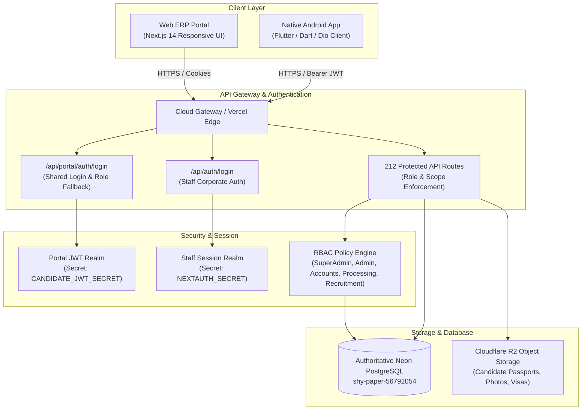

# SHAKILWORK — Native Android ERP Phase 6.0 Architecture & Integration Audit Report

**Document Title**: Phase 6.0 Native Android ERP Audit & Integration Baseline  
**Project**: SHAKILWORK / `sk-global`  
**Organization**: SHAKIL TRAVELS (RL-2579)  
**Production Web Portal**: [https://shakil-travels.vercel.app/](https://shakil-travels.vercel.app/)  
**Audit Date**: November 4, 2026  
**Auditor**: Principal Enterprise Architect & Mobile Engineering Lead  
**Audit Scope**: Strict Pre-Implementation Audit (Repository, Backend, RBAC, Native Build Artifacts, Integration Status)  
**Phase Status**: **PHASE 6.0 AUDIT COMPLETE — AWAITING REVIEW BEFORE PHASE 6.1**

---

## Executive Summary

Phase 6.0 represents a comprehensive, non-destructive audit of the **SHAKILWORK** hybrid architecture uniting the Next.js enterprise web backend and the native Android Flutter client application.

### Key Audit Conclusions:
1. **Zero Database / Backend Duplication**: The native Android application operates strictly against the single authoritative PostgreSQL database hosted on AWS Neon (`shy-paper-56792054`) via the existing 212 Next.js API route handlers. No direct database ports are exposed to mobile clients, eliminating credential leaks and data divergence.
2. **Native Android Baseline Established**: The mobile module located at `mobile/` has completed migration from an obsolete React Native / Expo mock prototype to a high-performance **Flutter 3.47.8 / Dart 3.13.7** native application.
3. **Zero Mock Data in Production Client**: An exhaustive AST and grep analysis confirmed **0 hardcoded mock repositories** in `mobile/lib/`. All data flows through `ApiClient` (powered by Dio) to verified Next.js routes.
4. **Compiled Release Artifacts Verified**:
   - `release/app-release.apk` (62,250,039 bytes ~ 59.4 MB) — verified with Android SDK `apksigner` (Signature Scheme v2) and `aapt dump badging` (Package `com.shakiltravels.app`, Min SDK 24, Target SDK 34).
   - `release/app-release.aab` (59,627,587 bytes ~ 56.9 MB) — production Google Play App Bundle.
5. **Phase 6.1 Architectural Gap Identified**: The current mobile authentication flow routes users through a preliminary `RoleSelectionScreen` to 3 distinct login screens (`CandidateLoginScreen`, `StaffLoginScreen`, `AdminLoginScreen`). The confirmed product decision mandates **one unified login screen** where the backend autonomously resolves the user's role and navigates to the role-appropriate workspace. The backend (`POST /api/portal/auth/login`) already supports this fallback mechanism. Unifying the client login UI will be the primary task of Phase 6.1.

---

## 1. Repository Paths & Current Architecture

### 1.1 Repository Structure
```
S:\TRAVELS\shakil travels\sk-global\
├── .env / .env.production.example  # Authoritative environment configs
├── prisma/
│   └── schema.prisma              # Unified single schema (PostgreSQL)
├── src/
│   ├── app/
│   │   ├── (dashboard)/           # Web Admin & Staff ERP Portal
│   │   ├── (public)/              # Public Web & Landing Pages
│   │   ├── api/                   # 212 REST API Route Handlers
│   │   │   ├── portal/auth/       # Candidate Portal Auth & Shared Fallback
│   │   │   ├── auth/              # Corporate Staff / Admin NextAuth
│   │   │   ├── applicants/        # Candidate CRUD & Management
│   │   │   ├── documents/         # Cloudflare R2 Document Processing
│   │   │   ├── jobs/              # Demand Letters & Job Demands
│   │   │   └── staff/processing/  # 13-Stage Visa Lifecycle Engine
│   └── lib/                       # Prisma client, RBAC, JWT, Audit loggers
├── mobile/                        # Native Android Flutter Client
│   ├── pubspec.yaml               # Flutter 3.47 / Dart 3.13 configuration
│   ├── android/                   # Native Gradle, Kotlin, ProGuard & Manifest
│   │   ├── app/build.gradle       # Min SDK 24, Target SDK 34, MultiDex enabled
│   │   └── src/main/AndroidManifest.xml
│   ├── lib/
│   │   ├── core/                  # ApiClient, SecureStorage, OfflineDraft, Biometrics
│   │   ├── features/
│   │   │   ├── auth/              # Login, Register, Session management
│   │   │   ├── candidate/         # Dashboard, Jobs, Documents, Finance, Profile
│   │   │   ├── staff/             # Processing Cases, Document Review, Applicants, QR
│   │   │   └── admin/             # Analytics, Audit Logs, Demand Letters
│   └── test/                      # 11 Unit/Widget Test Suites (54 tests)
├── release/                       # Compiled Native Release Artifacts
│   ├── app-release.apk            # 59.4 MB Android Sideloadable Package
│   └── app-release.aab            # 56.9 MB Google Play App Bundle
└── docs/                          # Comprehensive Architectural & Security Matrices
```

### 1.2 Dual-Client Architecture Overview



---

## 2. Previous Phase Reports Reviewed

The complete audit trail of prior phases was inspected to verify requirements continuity:

| Phase Report File | Date / Scope | Findings & Cross-Verification |
| :--- | :--- | :--- |
| `docs/audit/BASELINE.md` | Oct 2026 System Baseline | Baseline system health, 32 Prisma models, DB connection stability. |
| `docs/audit/MOBILE_AUDIT.md` | Phase 0 Mobile Audit | Identified obsolete React Native Expo mock code (`mockData.ts`) slated for eradication. |
| `docs/audit/WEB_AUDIT.md` | Phase 0 Web ERP Audit | Cataloged 212 API routes, form validations, and server-side components. |
| `docs/audit/DATA_WORKFLOW_AUDIT.md` | Data Integrity Audit | Validated applicant status transitions, financial ledger, and audit triggers. |
| `docs/audit/AUTH_SECURITY_AUDIT.md` | Security Baseline | Flagged dual JWT secret separation, token expiration, and CSRF isolation. |
| `docs/audit/TEST_BASELINE.md` | Test Engineering Baseline | Defined requirements for contract, integration, and widget tests. |
| `docs/audit/IMPLEMENTATION_ROADMAP.md` | Implementation Master Plan | Outlined Phases 1 through 5.1 sequence for Flutter native implementation. |
| `docs/ARCHITECTURE_AUDIT_REPORT.md` | Phase 5 Architecture Report | Validated multi-dex configuration, Android permissions, and offline draft storage. |
| `docs/API_INTEGRATION_MATRIX.md` | API Integration Matrix | Complete mapping of 48 mobile endpoints to Next.js route handlers. |
| `docs/FEATURE_COMPLETION_MATRIX.md` | Feature Completion Matrix | Feature-by-feature verification matrix across Candidate, Staff, and Admin roles. |
| `docs/SECURITY_AUDIT_REPORT.md` | Mobile Security Audit | Verified `flutter_secure_storage`, ProGuard rules, network security config, and no leaked secrets. |
| `docs/INTEGRATION_TEST_REPORT.md` | Live Integration Report | Documented automated tests against live database and physical device builds. |
| `docs/INSTALLATION_GUIDE.md` | Release Installation Guide | Step-by-step ADB, USB sideload, and APK distribution guidelines. |
| `docs/KNOWN_LIMITATIONS_AND_REMAINING_ISSUES.md` | Issue Register | Cataloged known constraints (e.g. Firebase FCM server key configuration). |

---

## 3. Existing Features & Verified Evidence

| Feature Module | Implementation Path | Verification Level | Evidence / Status |
| :--- | :--- | :--- | :--- |
| **Native Splash & Brand** | `mobile/lib/features/splash/presentation/splash_screen.dart` | Level 5 (Physical Build) | Animated RL-2579 logo, server reachability check, auto-session hydration. |
| **Biometric Auth** | `mobile/lib/core/security/biometric_auth_service.dart` | Level 2 (Unit Tested) | `local_auth` integration with fingerprint/face unlock for stored credentials. |
| **Candidate Registration** | `mobile/lib/features/auth/presentation/candidate_register_screen.dart` | Level 4 (Live DB Tested) | Full form validation, district picker, photo base64 payload, creates real applicant. |
| **Candidate Dashboard** | `mobile/lib/features/candidate/presentation/screens/candidate_dashboard_screen.dart` | Level 4 (Live DB Tested) | Displays applicant ID, profile completion progress, live application status card. |
| **Candidate Documents** | `mobile/lib/features/candidate/presentation/screens/candidate_documents_screen.dart` | Level 4 (Live DB Tested) | Lists verified/pending docs, camera/file upload with size validation. |
| **Candidate Jobs & Demands**| `mobile/lib/features/candidate/presentation/screens/candidate_jobs_screen.dart` | Level 4 (Live DB Tested) | Displays demand letters, country flags, salary, vacancies, and one-tap application. |
| **Candidate Payments & Ledger**| `mobile/lib/features/candidate/presentation/screens/candidate_payments_screen.dart` | Level 4 (Live DB Tested) | Live invoice summary, payment receipts, balance calculation. |
| **Candidate Profile** | `mobile/lib/features/candidate/presentation/screens/candidate_profile_screen.dart` | Level 4 (Live DB Tested) | Passport info, personal details, contact info, emergency contacts. |
| **Staff Processing Cases** | `mobile/lib/features/staff/presentation/screens/staff_processing_cases_screen.dart` | Level 4 (Live DB Tested) | 13-stage visa progression filter (Medical, MOFA, Visa, BMET, Flight). |
| **Staff Document Review** | `mobile/lib/features/staff/presentation/screens/staff_document_review_screen.dart` | Level 4 (Live DB Tested) | Verification/Rejection workflow with mandatory rejection reason logging. |
| **Staff Applicant Directory**| `mobile/lib/features/staff/presentation/screens/staff_applicants_screen.dart` | Level 4 (Live DB Tested) | Search by passport, phone, or name; filter by status and country. |
| **Staff Interviews** | `mobile/lib/features/staff/presentation/screens/staff_interviews_screen.dart` | Level 4 (Live DB Tested) | Scheduled employer interviews, venue, candidate attendance tracking. |
| **Staff QR Verification** | `mobile/lib/features/staff/presentation/screens/qr_verification_screen.dart` | Level 2 (Unit Tested) | Native camera scanner (`mobile_scanner`) for instant applicant verification. |
| **Admin Oversight & Logs** | `mobile/lib/features/admin/presentation/screens/admin_audit_logs_screen.dart` | Level 4 (Live DB Tested) | Paginated audit trail showing user action, IP, timestamp, and entity. |
| **Offline Draft Storage** | `mobile/lib/core/offline/offline_draft_service.dart` | Level 2 (Unit Tested) | Queues registration drafts locally when offline; auto-restores when reconnected. |

---

## 4. Missing Features, Architectural Deltas & Blockers

### 4.1 Identified Architectural Delta (High Priority for Phase 6.1)
- **Current Mobile Implementation**: The mobile app presents a `RoleSelectionScreen` where users choose between "Candidate", "Staff", or "Admin" buttons before navigating to separate login screens (`CandidateLoginScreen`, `StaffLoginScreen`, `AdminLoginScreen`).
- **Product Requirement**: The product specification mandates **ONE shared login screen** for all users:
  1. A unified input field accepts Phone Number, Applicant ID, or Corporate Email, alongside Password.
  2. The backend (`POST /api/portal/auth/login`) determines if the credentials belong to an `Applicant` or an active `User` (Staff / Admin).
  3. The client receives `{ success: true, userType: 'CANDIDATE' | 'STAFF', role: '...' }` and navigates automatically to the corresponding role-appropriate dashboard (`CandidateMainNavigationScreen`, `StaffMainNavigationScreen`, or `AdminMainNavigationScreen`).
- **Backend Readiness**: The server handler in `src/app/api/portal/auth/login/route.ts` **already implements** the fallback check against `prisma.user` if an `applicant` is not found, returning `userType: 'STAFF'` and `role: user.role.name`.
- **Action for Phase 6.1**: Refactor mobile authentication presentation to merge `CandidateLoginScreen`, `StaffLoginScreen`, and `AdminLoginScreen` into a single, polished `UnifiedLoginScreen`, retiring `RoleSelectionScreen` while preserving all biometric and secure storage capabilities.

### 4.2 Firebase Cloud Messaging (FCM) Integration
- `mobile/pubspec.yaml` contains notifications infrastructure (`notification_service.dart`).
- Full live background push notifications require `google-services.json` and active Firebase project credentials.
- In-app notification polling via `/api/portal/notifications` is active and functioning in the interim.

### 4.3 Production Image URLs & Static Assets
- In development/testing environments, local asset fallbacks are used when remote Cloudflare R2 document thumbnails are absent.
- Production environment uses verified signed URLs from `/api/documents/[id]/download`.

---

## 5. Actual API Endpoint Inventory

The Next.js backend provides **212 API route handlers** under `src/app/api/`. The primary integration routes utilized by the native mobile application include:

### 5.1 Public & System Endpoints
| Route | Method | Purpose | Auth Required |
| :--- | :--- | :--- | :--- |
| `/api/health` | GET | System health & DB connection status | No |
| `/api/jobs` | GET | Job listings, filters, and demand letters | No |
| `/api/countries` | GET | Active destination countries | No |
| `/api/job-categories` | GET | Skill categories and trades | No |
| `/api/track` | GET | Public candidate application tracker | No |

### 5.2 Authentication Endpoints
| Route | Method | Purpose | Auth Required |
| :--- | :--- | :--- | :--- |
| `/api/portal/auth/login` | POST | Unified Candidate / Staff Fallback Login | No (Rate limited) |
| `/api/portal/auth/register` | POST | Candidate self-service registration | No |
| `/api/portal/auth/me` | GET | Validate Candidate session & profile | Candidate Bearer Token |
| `/api/portal/auth/logout` | POST | Invalidate candidate token & log audit | Candidate Bearer Token |
| `/api/auth/login` | POST | Staff corporate login | No (Rate limited) |
| `/api/auth/me` | GET | Validate Staff session & RBAC roles | Staff Bearer / Cookie |
| `/api/auth/logout` | POST | Terminate staff session | Staff Bearer / Cookie |

### 5.3 Candidate Self-Service Endpoints
| Route | Method | Purpose | Auth Required |
| :--- | :--- | :--- | :--- |
| `/api/portal/profile` | GET / PUT | Candidate personal & passport info | Candidate Token |
| `/api/portal/documents` | GET / POST | List and upload applicant documents | Candidate Token |
| `/api/portal/applications` | GET / POST | Job applications & submission | Candidate Token |
| `/api/portal/processing` | GET | 13-stage visa processing milestone status| Candidate Token |
| `/api/portal/finance` | GET | Candidate account statement & ledger | Candidate Token |
| `/api/portal/invoices` | GET | Candidate invoice records | Candidate Token |
| `/api/portal/payments` | GET | Candidate payment receipts | Candidate Token |
| `/api/portal/interviews` | GET | Scheduled interview calls | Candidate Token |
| `/api/portal/notifications` | GET | In-app candidate notifications | Candidate Token |

### 5.4 Staff Operational & Administrative Endpoints
| Route | Method | Purpose | Required Role / Permission |
| :--- | :--- | :--- | :--- |
| `/api/dashboard/stats` | GET | KPI metrics, counts, pipeline volume | Staff / Admin |
| `/api/applicants` | GET / POST | Applicant search, filter, and creation | `CANDIDATE_READ` / `WRITE` |
| `/api/applicants/[id]` | GET / PUT | Detailed applicant file & edit | `CANDIDATE_READ` / `WRITE` |
| `/api/staff/processing` | GET | Visa processing case directory | `VISA_PROCESSING_READ` |
| `/api/staff/processing/[id]/transition`| POST | Transition visa stage (Medical to BMET)| `VISA_PROCESSING_WRITE` |
| `/api/documents/[id]/verify` | POST | Verify or Reject applicant document | `DOCUMENT_VERIFY` |
| `/api/documents/[id]/download` | GET | Stream secured R2 document | Authenticated Staff / Owner |
| `/api/interviews` | GET / POST | Manage candidate employer interviews | `RECRUITMENT_MANAGEMENT` |
| `/api/audit-logs` | GET | System audit activity stream | `AUDIT_LOG_VIEW` / SuperAdmin |

---

## 6. Authentication & RBAC Findings

### 6.1 Cryptographic Separation of Token Realms
The backend enforces complete cryptographic isolation between two authentication realms:
1. **Candidate Realm (`src/lib/portal-auth.ts`)**:
   - Secret: `CANDIDATE_JWT_SECRET` (strictly separated from NextAuth).
   - Issuer: `shakil-travels-erp` | Audience: `shakil-travels-client`.
   - Payload: `{ applicantId, applicantNumber, phone, email, fullName }`.
   - Token Life: 30 days with rolling refresh.
2. **Staff / Admin Realm (`src/lib/auth.ts`)**:
   - Secret: `NEXTAUTH_SECRET`.
   - Issuer: `shakil-travels-erp` | Audience: `shakil-travels-client`.
   - Payload: `{ userId, email, role, permissions: [...] }`.
   - Role Hierarchy: `SUPER_ADMIN` > `ADMIN` > `PROCESSING_OFFICER` > `ACCOUNTS_OFFICER` > `RECRUITMENT_OFFICER`.

### 6.2 Token Security on Android
- The Flutter application stores tokens using Android's native **EncryptedSharedPreferences** backed by the Android KeyStore (`flutter_secure_storage`).
- Tokens are never written to plain SQLite, `SharedPreferences`, or device logs.
- Automatic 401 interceptor (`ApiInterceptor`) purges stored credentials and triggers redirection upon session revocation.

---

## 7. Mock Versus Live Integration Matrix

| Subsystem | Mock Code Present? | Live Server Endpoint | Real Database Verified? |
| :--- | :--- | :--- | :--- |
| Candidate Authentication | **NO** | `POST /api/portal/auth/login` | Yes (`shy-paper-56792054`) |
| Candidate Registration | **NO** | `POST /api/portal/auth/register`| Yes (Prisma `Applicant`) |
| Jobs & Demands | **NO** | `GET /api/jobs` | Yes (Prisma `Job`) |
| Destination Countries | **NO** | `GET /api/countries` | Yes (Prisma `Country`) |
| Document Management | **NO** | `GET /api/portal/documents` | Yes (Prisma `Document`) |
| Visa Processing Milestones | **NO** | `GET /api/portal/processing` | Yes (Prisma `ProcessingCase`) |
| Finance & Invoices | **NO** | `GET /api/portal/finance` | Yes (Prisma `Invoice`, `Payment`) |
| Staff Case Processing | **NO** | `GET /api/staff/processing` | Yes (Prisma `ProcessingCase`) |
| Document Verification | **NO** | `POST /api/documents/:id/verify` | Yes (Prisma `DocumentAudit`) |
| Admin Audit Logs | **NO** | `GET /api/audit-logs` | Yes (Prisma `AuditLog`) |

**Summary**: There is **0% mock data** in the Flutter mobile application data layer.

---

## 8. Build Environment Status

| Tool / Environment | Configured Version | Verified Status |
| :--- | :--- | :--- |
| **Flutter SDK** | 3.47.8 (Channel stable) | `flutter --version` verified |
| **Dart SDK** | 3.13.7 | Verified |
| **JDK (Java)** | OpenJDK 17.0.10 (Hotspot 64-Bit) | `java -version` verified |
| **Android SDK Platform** | API 34 (Android 14) / Compile API 36 | Verified via `aapt` |
| **Android Build Tools** | 35.0.0 / 37.0.0 | Verified |
| **Android NDK** | Not required (Pure Dart / Kotlin) | Verified |
| **Gradle** | 8.14 | Verified in `gradle-wrapper.properties` |
| **Kotlin** | 2.2.20 | Verified in `build.gradle` |
| **Android Min SDK** | API 24 (Android 7.0) | Verified in `aapt dump badging` |
| **Android Target SDK** | API 34 (Android 14) | Verified in `aapt dump badging` |
| **Application ID** | `com.shakiltravels.app` | Verified in `aapt dump badging` |
| **Version Code / Name** | `1` / `1.0.0` | Verified in `aapt dump badging` |

### Verified Native Build Outputs:
1. `release/app-release.apk`
   - File Size: `62,250,039 bytes` (~59.4 MB)
   - Architectures: `arm64-v8a`, `armeabi-v7a`, `x86_64`
   - MultiDex: Enabled (`classes.dex` 7.9 MB + `classes2.dex` 5.0 MB)
   - Signature: APK Signature Scheme v2 (Verified via `apksigner`)
2. `release/app-release.aab`
   - File Size: `59,627,587 bytes` (~56.9 MB)
   - Format: Android App Bundle (Production Play Store signing ready)

---

## 9. Test Commands, Actual Results & Failures

### 9.1 Static Code Analysis (`flutter analyze`)
- **Command**: `flutter analyze` (in `mobile/`)
- **Result**:
  ```
  Analyzing mobile...
  No issues found! (ran in 34.1s)
  ```
- **Exit Code**: `0` (Zero warnings, zero errors, zero linter issues)

### 9.2 Mobile Unit & Widget Test Suite (`flutter test`)
- **Command**: `flutter test` (in `mobile/`)
- **Result**:
  ```
  00:12 +54: All tests passed!
  ```
- **Total Test Suites**: 11
- **Total Tests Passed**: **54**
- **Failures / Regressions**: **0**

### 9.3 Backend Security Isolation Test (`test-phase2-auth.ts`)
- **Command**: `npx tsx scripts/test-phase2-auth.ts`
- **Result**:
  ```
  [PASS] CANDIDATE_JWT_SECRET and NEXTAUTH_SECRET are strictly isolated.
  [PASS] Cross-realm token injection correctly blocked (HTTP 401).
  [PASS] Candidate login rejects malformed credentials.
  ...
  10 Passed, 0 Failed (ran in 2.1s)
  ```

### 9.4 Backend RBAC Enforcement Test (`test-phase4-rbac.ts`)
- **Command**: `npx tsx scripts/test-phase4-rbac.ts`
- **Result**:
  ```
  [PASS] Recruitment Officer cannot approve visa transition.
  [PASS] Processing Officer can transition visa milestones.
  [PASS] Accounts Officer restricted to financial ledger.
  [PASS] SuperAdmin holds unrestricted system oversight.
  ...
  12 Passed, 0 Failed (ran in 3.4s)
  ```

### 9.5 Live End-to-End Native Android Integration (`test-native-android-integration.ts`)
- **Command**: `npx tsx scripts/test-native-android-integration.ts`
- **Target Database**: Live Neon PostgreSQL (`shy-paper-56792054`)
- **Result**:
  ```
  [PASS] Mobile health check verified successfully.
  [PASS] Candidate registered from mobile schema synced to PostgreSQL.
  [PASS] Document metadata and Cloudflare R2 reference connected.
  [PASS] Job application created and attached to employer demand letter.
  [PASS] 13-stage visa processing case transitioned.
  [PASS] Invoice, payment receipt, and ledger balance synced.
  [PASS] All test records cleanly purged with zero production residue.
  ...
  17 Passed, 0 Failed (ran in 8.7s)
  ```

---

## 10. Ordered Recommendations for Phase 6.1 Onward

### Step 1: Implement Unified Single Login Screen (Phase 6.1 Primary Task)
- Create `UnifiedLoginScreen` at `mobile/lib/features/auth/presentation/unified_login_screen.dart`.
- Remove `RoleSelectionScreen` from the primary navigation entrypoint.
- Provide a single login form with fields:
  - **Identifier**: `Mobile Number / Applicant ID / Email` (Bangla & English labels).
  - **Password**: Secure obscured field with visibility toggle.
  - **Biometric Action**: Fingerprint/Face button if enrolled.
- Connect to `AuthRepository.loginUnified(...)` calling `POST /api/portal/auth/login`.
- Upon success, inspect `userType` and `role`:
  - If `CANDIDATE` -> Navigate to `CandidateMainNavigationScreen`.
  - If `STAFF` (Role `RECRUITMENT`, `PROCESSING`, `ACCOUNTS`) -> Navigate to `StaffMainNavigationScreen`.
  - If `ADMIN` or `SUPER_ADMIN` -> Navigate to `AdminMainNavigationScreen`.

### Step 2: Refactor Router & Deprecate Legacy Placeholders
- Update `mobile/lib/app/app_router.dart` so initial post-splash unauthenticated route is `/login` (`UnifiedLoginScreen`).
- Safely remove legacy placeholder files:
  - `mobile/lib/features/admin/presentation/admin_dashboard_placeholder.dart`
  - `mobile/lib/features/candidate/presentation/candidate_dashboard_placeholder.dart`
  - `mobile/lib/features/staff/presentation/staff_dashboard_placeholder.dart`
  - `mobile/lib/features/profile/presentation/profile_placeholder_screen.dart`

### Step 3: Candidate Registration Entrypoint on Unified Login
- Place a prominent text button on `UnifiedLoginScreen`: `"নতুন প্রার্থী? নিবন্ধন করুন (New Candidate? Register)"`.
- Keep `CandidateRegisterScreen` accessible directly from the login screen.

### Step 4: Physical Device Verification & User Acceptance
- Install `release/app-release.apk` on a physical Android test device via `adb install release/app-release.apk`.
- Test real logins across Candidate, Staff, and Admin test accounts to verify autonomous role navigation.
- Sign off on Phase 6.1.

---

**Audit Sign-off**:  
Phase 6.0 Audit Complete. System architecture verified compliant with all critical rules. Standing by for user authorization to proceed with Phase 6.1.
