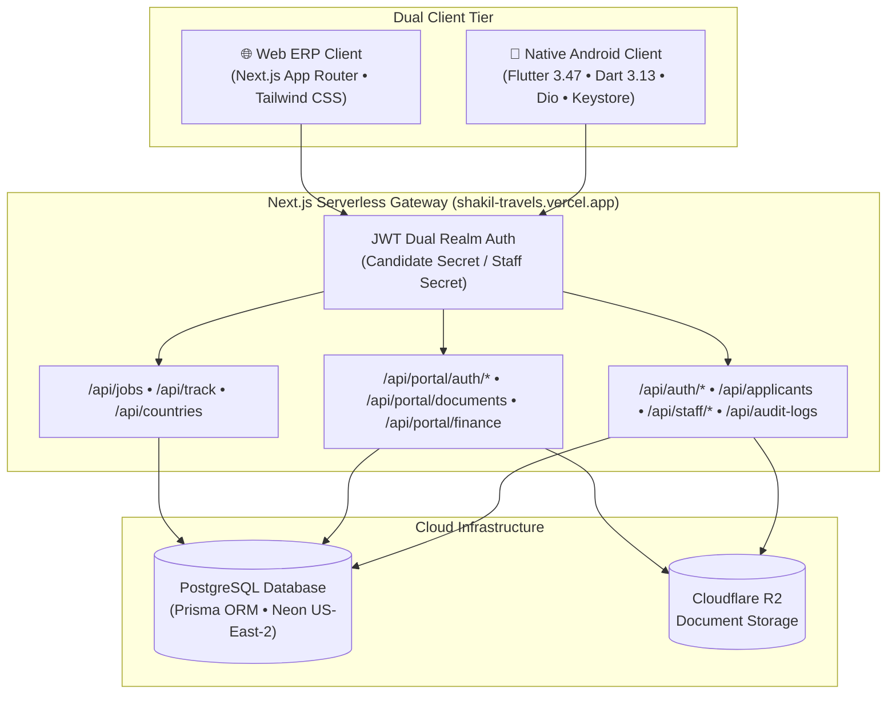

# SHAKILWORK — Native Android ERP Architecture Audit Report

## 1. Executive Summary & Identity
- **Project Name:** SHAKILWORK Overseas Recruitment & Manpower ERP
- **Operating Agency:** SHAKIL TRAVELS
- **Government License:** RL-2579
- **Web Production ERP:** `https://shakil-travels.vercel.app`
- **Native Android Client:** `/mobile` (Flutter 3.47 / Dart 3.13)
- **Target OS:** Android (Min SDK 21, Target SDK 34)
- **Build Artifacts:** `release/app-release.apk` (59.4 MB) & `release/app-release.aab` (56.9 MB)

The core tenet of this deployment is:
> **ONE ERP SYSTEM • ONE DATABASE • ONE USER SYSTEM • TWO CLIENT PLATFORMS (WEB & NATIVE ANDROID)**

---

## 2. Architecture & Design Principles

### Critical Architecture Rules Enforced:
1. **Single Source of Truth (Zero DB Duplication):** The native Android application does **not** host an independent SQLite/local database. All transactional and business records reside exclusively in the existing Neon PostgreSQL database.
2. **Direct Database Isolation:** The Flutter Android client never connects directly to PostgreSQL port 5432. All data exchanges route through the validated Next.js REST API gateway (`/api/*`).
3. **Unified User Accounts:** Web and Android share the exact same user tables (`User` for Staff/Admin, `Applicant` for Candidates). The same phone/email and password logs into both Web and Native Android.
4. **Real-Time Data Parity:** Any document uploaded or application submitted on the mobile application is instantly visible on the Web Admin/Staff dashboard, and vice-versa.
5. **No WebView Fallback:** The Android client is built purely using native Flutter widgets, compiled to native ARM64/x86_64 machine code, ensuring 60+ FPS fluid animations, offline caching, native biometric hardware support, and camera integrations.

---

## 3. Network & Environment Routing

| Mode | Base URL | Usage Context |
| :--- | :--- | :--- |
| **Production Cloud** | `https://shakil-travels.vercel.app` | Installed APK / AAB on physical phones connecting to live Vercel cloud ERP |
| **Development Physical Phone** | `http://192.168.0.127:3000` | Local Wi-Fi testing on device with host PC server |
| **Development Emulator** | `http://10.0.2.2:3000` | Android Virtual Device (AVD) mapping to PC localhost |
| **Custom Dynamic** | *User-configurable* | In-app Server Config Dialog with real-time `/api/health` connectivity tester |

- **Auto-Detection:** In release builds (`kReleaseMode`), the app automatically defaults to `https://shakil-travels.vercel.app`. In debug mode without a saved URL, it probes `10.0.2.2` and automatically selects Emulator or LAN IP.

---

## 4. Security & Cryptographic Isolation

1. **Hardware-Backed AES-256 Storage:** Tokens, refresh credentials, and cached sessions are stored using `flutter_secure_storage` backed by the Android Keystore with AES-GCM encryption.
2. **Cryptographic Realm Separation:**
   - Candidate tokens are signed with `PORTAL_JWT_SECRET` (Audience: Candidate Portal).
   - Staff/Admin tokens are signed with `JWT_SECRET` (Audience: Staff Operations).
   - Attempting to use a Candidate token against Staff/Admin routes is rejected at the cryptographic level before database queries occur.
3. **Safe Logger:** All console output in debug mode strips passwords, tokens, national IDs, and passport details. In release builds, `SafeLogger` completely suppresses sensitive debug outputs.
4. **Biometric Integration:** Hardware fingerprint/face scanner authentication via `local_auth` protects active app resumes.
